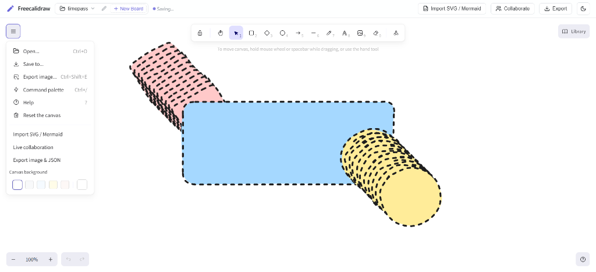

# Freecalidraw

Freecalidraw is an open-source, privacy-first, self-hosted virtual whiteboard with local multi-board management, client-side end-to-end encrypted collaboration, and 1:1 geometric SVG and Mermaid diagram decomposition.

[](LICENSE)
[](https://github.com/gaurav-abhiman-mahajan/freecalidraw/actions/workflows/ci.yml)
[](https://github.com/gaurav-abhiman-mahajan/freecalidraw/actions/workflows/deploy.yml)
[](https://gaurav-abhiman-mahajan.github.io/freecalidraw/)
[](docker-compose.yml)
[]()
[]()

<p align="center">
  
</p>

---

## Overview

Freecalidraw provides an alternative to proprietary, subscription-based diagramming tools. It combines the hand-drawn canvas experience of Excalidraw with features normally restricted behind paid tiers, including local multi-board management, automated 1:1 vector SVG decomposition, and zero-knowledge end-to-end encrypted real-time collaboration.

### Key capabilities

* **Local multi-board management**: Create, switch, rename, duplicate, and delete multiple independent whiteboards in your browser without creating an account or paying for cloud workspaces.
* **1:1 SVG to diagram conversion**: Parse vector geometries from SVGs (Mermaid, PlantUML, draw.io, Visio, Graphviz) into native Excalidraw shapes, connectors, and labels with spatial binding.
* **Mermaid architecture support**: Native compilation of Mermaid flowcharts, sequence diagrams, class diagrams, and C4 architecture definitions into editable canvas elements.
* **End-to-end encrypted collaboration**: Real-time multiplayer synchronization over WebSockets with 256-bit AES-GCM client-side encryption. The server relay handles only blind ciphertext.
* **Unified file opener**: Open `.excalidraw`, `.json`, `.png`, and any `.svg` file directly using `Ctrl+O` or drag-and-drop without `IMAGE_NOT_CONTAINS_SCENE_DATA` errors.
* **100% offline and self-hosted**: All fonts (Virgil, Cascadia, Assistant, Excalifont) and assets are bundled locally. Zero external CDN or cloud dependencies.
* **Production Docker deployment**: Multi-stage Docker container with automated healthchecks and an always-on restart policy.

---

## Feature comparison

| Feature | Excalidraw Free | Excalidraw+ (Paid SaaS) | Freecalidraw (Open Source) |
| :--- | :--- | :--- | :--- |
| **Pricing** | Free | \$7 / user / mo | **Free & Open Source (MIT)** |
| **Hosting** | Cloud (excalidraw.com) | Cloud (plus.excalidraw.com) | **Self-hosted / Local / Docker** |
| **Multi-board storage** | Single active board | Cloud folders & workspaces | **Built-in multi-board local switcher** |
| **Board renaming & management** | Limited | Yes | **Yes (instant inline renamer)** |
| **SVG to connected diagram** | No (inserts static image) | No | **Yes (1:1 shape & connector parsing)** |
| **Mermaid architecture import** | Basic | Basic | **Yes (source syntax & vector SVG)** |
| **Real-time collaboration** | Ephemeral | Cloud workspace | **Yes (E2EE 256-bit AES-GCM relay)** |
| **Offline runtime** | Partial (requires CDN) | No | **100% Offline (bundled assets)** |
| **Zero telemetry / data lock-in** | No | No | **Yes (zero external tracking)** |

---

## Table of contents

- [Quickstart](#quickstart)
  - [Option 1: Docker (Recommended)](#option-1-docker-recommended)
  - [Option 2: Local development](#option-2-local-development)
- [Local domain alias setup](#local-domain-alias-setup)
- [Features in depth](#features-in-depth)
  - [1:1 SVG to diagram conversion](#11-svg-to-diagram-conversion)
  - [Mermaid architecture compiler](#mermaid-architecture-compiler)
  - [End-to-end encrypted collaboration](#end-to-end-encrypted-collaboration)
  - [Multi-board persistence](#multi-board-persistence)
- [Keyboard shortcuts](#keyboard-shortcuts)
- [Architecture](#architecture)
- [Configuration](#configuration)
- [Security policy](#security-policy)
- [Contributing](#contributing)
- [License](#license)

---

## Quickstart

### Option 1: Docker (Recommended)

Clone the repository and start the container in detached mode:

```bash
git clone https://github.com/gaurav-abhiman-mahajan/freecalidraw.git
cd freecalidraw
docker compose up --build -d
```

The application is immediately available at:
* Standard port 80: [http://localhost/](http://localhost/)
* Secondary port 8090: [http://localhost:8090/](http://localhost:8090/)

### Option 2: Local development

#### Prerequisites
* Node.js 20 or higher
* npm 10 or higher

```bash
# 1. Clone and enter directory
git clone https://github.com/gaurav-abhiman-mahajan/freecalidraw.git
cd freecalidraw

# 2. Install dependencies
npm install

# 3. Start development server and collaboration relay
npm start
```

* Web app: `http://localhost:5173/`
* Collaboration WebSocket relay: `ws://localhost:3002`

---

## Local domain alias setup

To access Freecalidraw at `http://freecalidraw.local` without specifying ports:

### Windows
1. Double-click [setup-domain.bat](setup-domain.bat) in the project root.
2. When prompted by Windows UAC, click **Yes** to append `127.0.0.1 freecalidraw.local` to `C:\Windows\System32\drivers\etc\hosts`.

### macOS / Linux
Add the host entry to `/etc/hosts`:
```bash
echo "127.0.0.1 freecalidraw.local" | sudo tee -a /etc/hosts
```

Then open [http://freecalidraw.local](http://freecalidraw.local) in your browser.

---

## Features in depth

### 1:1 SVG to diagram conversion

Standard Excalidraw treats imported SVGs as flat, uneditable static images. Freecalidraw inspects the SVG structure:
* **Decomposition algorithm**: Vector rectangles, circles, paths, and text labels are transformed into native Excalidraw elements.
* **Connected arrows**: Connection paths are translated into two-point or multi-point arrow elements with spatial binding to source and target shapes.
* **Intelligent fallback**: If an SVG does not contain structured diagram shapes (e.g., icons or photos), Freecalidraw inserts it cleanly as a static image without throwing errors.

### Mermaid architecture compiler

Paste Mermaid code (flowcharts, sequence diagrams, class models, C4 diagrams) directly via the **Import SVG / Mermaid** dialog. Freecalidraw compiles the text into native canvas elements that you can edit, restyle, and reposition.

### End-to-end encrypted collaboration

Collaboration sessions use client-side 256-bit AES-GCM encryption:
1. When a room is created, the browser generates an ephemeral cryptographic key using the Web Crypto API (`window.crypto.subtle`).
2. The key is stored in the URL fragment (`#room=<id>,key=<key>`). URL fragments are never sent to HTTP servers in requests.
3. Scene updates, element changes, and peer pointer movements are encrypted client-side before transmission.
4. The WebSocket relay server handles opaque ciphertext only and cannot inspect canvas contents.

### Multi-board persistence

* Switch between multiple whiteboards with the topbar dropdown.
* Rename any board inline by clicking the edit icon or pressing `Enter`.
* All boards persist in browser storage (`localStorage` and IndexedDB).
* Isolated board states ensure that edits on one board never overwrite or leak into another.

---

## Keyboard shortcuts

| Action | Shortcut |
| :--- | :--- |
| **Open file** | `Ctrl + O` / `Cmd + O` |
| **Save / Export** | `Ctrl + S` / `Cmd + S` |
| **Undo** | `Ctrl + Z` / `Cmd + Z` |
| **Redo** | `Ctrl + Shift + Z` / `Ctrl + Y` |
| **Pan canvas** | `Space + Drag` or Middle Mouse |
| **Zoom in / out** | `Ctrl + Mouse Wheel` |
| **Delete selection** | `Delete` / `Backspace` |
| **Group / Ungroup** | `Ctrl + G` / `Ctrl + Shift + G` |

---

## Architecture

```
freecalidraw/
├── .github/
│   ├── workflows/ci.yml         # GitHub Actions build and type-checking workflow
│   ├── ISSUE_TEMPLATE/          # Bug report and feature request templates
│   └── PULL_REQUEST_TEMPLATE.md # Contributor pull request checklist
├── src/
│   ├── components/
│   │   ├── TopBar.tsx           # Multi-board selector, inline renamer, theme toggle
│   │   ├── CollabModal.tsx      # E2EE collaboration dialog and room sharing
│   │   ├── ExportModal.tsx      # PNG, SVG, and JSON scene export modal
│   │   ├── MermaidModal.tsx     # SVG analysis, diagram decomposition, Mermaid UI
│   │   └── PeerCursors.tsx      # Real-time multiplayer cursor rendering
│   ├── services/
│   │   ├── storage.ts           # Multi-board persistence and state migration
│   │   ├── crypto.ts            # Web Crypto 256-bit AES-GCM encryption engine
│   │   ├── collab.ts            # WebSocket synchronization and presence protocol
│   │   ├── mermaidSvg.ts        # Mermaid compilation and SVG parser
│   │   └── svgDiagramConverter.ts # 1:1 vector SVG to Excalidraw element converter
│   ├── styles/
│   │   └── app.css              # Theme variables and application styles
│   ├── App.tsx                  # Canvas controller and open-file handler
│   └── main.tsx                 # React entry point and local font registration
├── server/
│   ├── collab-server.js         # Standalone WebSocket collaboration relay
│   └── prod-server.js           # Production Express static and WebSocket server
├── public/                      # Bundled offline fonts (Virgil, Cascadia, Assistant)
├── Dockerfile                   # Multi-stage production container
├── docker-compose.yml           # Always-on container configuration
├── LICENSE                      # MIT License
├── SECURITY.md                  # Security and encryption documentation
└── CONTRIBUTING.md              # Contribution guidelines
```

---

## Configuration

Freecalidraw is preconfigured to run out of the box with zero setup. You can adjust ports via `.env` or environment variables:

| Variable | Default | Description |
| :--- | :--- | :--- |
| `PORT` | `3000` | Internal server port |
| `FREECALIDRAW_PORT` | `8090` | Secondary host port for HTTP access in Docker |
| `NODE_ENV` | `production` | Node runtime environment |

---

## Security policy

For information on Freecalidraw's security architecture or to report a vulnerability, see [SECURITY.md](SECURITY.md).

---

## Contributing

Contributions are welcome. Please read [CONTRIBUTING.md](CONTRIBUTING.md) and [CODE_OF_CONDUCT.md](CODE_OF_CONDUCT.md) before submitting pull requests.

---

## License

Freecalidraw is open-source software licensed under the [MIT License](LICENSE).
